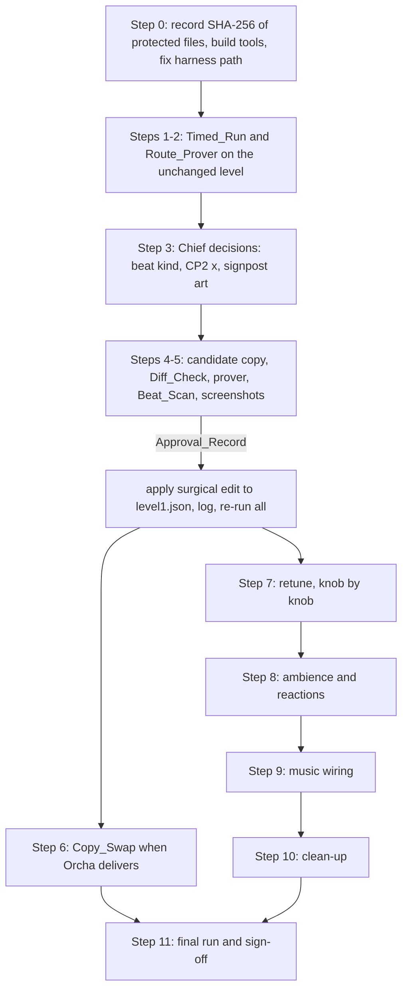

# Design Document: Level 1 Finish

## Overview

This design finishes Level 1 ("NEON RISE") on branch `agent/orcha-gameplay`, base commit `86bcc78`. It turns the 13 requirements into concrete scripts, runtime changes, data shapes and a safe order of work. The language is JavaScript (ES modules, Node 24 for tools, plain browser modules for the game). The repo has no root `package.json`, so no npm test dependency is added. Every check is a plain `node` command.

The design has five parts:

1. Measurement tools that read the real level and run the real controller: Timed_Run, Route_Prover, Beat_Scan.
2. Change-control tools that protect `level1.json`: Diff_Check, a text-level edit tool, the placement and approval procedure, the protected-file check.
3. Runtime changes: Gate_Glow, charged-object reactions, ambience, music, effect registry and off switches.
4. The movement retune with a one-step rollback.
5. Clean-up, final run and sign-off.

### Status tags

Every decision in this document carries one of four tags, as in the requirements.

- **CONFIRMED**: Chief decided it, or it was read from a real file or command output during this design.
- **RECOMMENDED**: Kiro's proposal. Chief may change it.
- **CONCEPT**: an idea, not adopted, nothing is built for it.
- **OPEN**: no decision. Recorded and reported, not decided here.

### What was read and run to ground this design (CONFIRMED)

All of this was read-only. Temporary probe scripts were written to the system temp folder and deleted. No repo file was changed, and no `level1.json` byte was touched.

| Finding | Source | Why it matters |
|---|---|---|
| `level1.json` is 22 rows x 100 cols. Sources: lamps at x 451, 933, 1664 (3 each), vending machine x 2035 (2), AC `AC_TENANT` x 32 y 100 (capacity 4, `uncharged`). One gate `gate_1` x 3136 y 544, `required` 8, `isExit`. One checkpoint `CP1` x 1824 y 448. 7 NPCs. 139 decorations. 2 ladders (x 128 y 384 h 224; x 352 y 128 h 256). | parsed with node | These are the figures Diff_Check and the economy checks pin. |
| The committed blob at `86bcc78` is LF, no final newline, and equals `JSON.stringify(parsed, null, 2)` exactly. The working copy is CRLF (`core.autocrlf=true`, index LF, worktree CRLF) and also round-trips when CRLF is used. | `git show 86bcc78:...`, `git ls-files --eol` | The requirement text says the file "does not round-trip". Today it does, in both EOL styles. The standing-orders log says Builder saves once produced mixed endings. The design still mandates text-level edits (R11.5), because a Builder save or a tool that writes a trailing newline (`facade_routes.mjs --apply` does) can break it again. Diff_Check must normalise CRLF to LF before comparing to the base blob. |
| `_dev/run_all.mjs` runs every top-level `_dev/*.mjs` except the `SKIP` map, 180 s timeout each. It counts a suite only if the output has a line `RESULTS: N passed, M failed`. Sub-folders such as `_dev/tools/` are never scanned. | `_dev/run_all.mjs` | New automatic suites must print that line. Tools placed in `_dev/tools/` are not run automatically. |
| `reach.mjs` drives the real `Player`/`Level`/`Input` at 60 Hz with a breadth-first search over 9 key actions and an 8 px grid. It has no ladder action and it can only start from `playerStart`. On the real level: gate reached, 493 states, 222 ms. Full closure: 506 states. | ran a probe | The prover is feasible and fast. It must be extended (ladders, arbitrary start, edge recording). `reach.mjs` itself stays unchanged. |
| From the spawn closure, the lamps and the vending machine are reachable from the gate and the gate from each of them. The AC is not reachable without ladder moves. A probe that "started" at the AC returned success only because the start state was in mid-air and fell to the street, which is a one-way drop. | probe on the real level | Starts must be anchored on a standing surface. Ladders must be real actions. Two-way means both directions recorded. |
| A greedy walker (hold right, jump at a wall or an edge) crosses spawn to gate in **41.3 s** of game time, with no absorbs and no dwell. It also fell into the low street at x about 1600 and walked under the strip. | probe, 60 Hz, real controller | The walker must be planned, not greedy. It also shows the 90 to 120 s target is probably out of reach for the plain main route (see Risks, R-3). This is a probe, not the Timed_Run. |
| `docs/reference/agent-training/player_metrics_harness.mjs` **cannot run where it is**. It imports `../../_dev/support/headless.mjs`, which resolves to `docs/_dev/...`. It was moved from `docs/agent-training/` and its two import paths were never fixed. With the paths corrected (probe copy only) it reproduces Appendix A.1 "Before" exactly (walk 75.00, sprint 127.50, jump 99.17 px, apex 27 frames, airtime 56 frames, gap 1/3 tiles, ledge 3 tiles, terminal 700, 66 frames). | ran a corrected copy | The harness needs a two-line path fix before any retune. The baseline is still valid at `86bcc78`. |
| `player.js` has **no** jump cut, no fall multiplier, no walk ramp (horizontal speed snaps), and `main.js`/`camera.js` have no horizontal look-ahead. Jump is a fixed impulse (`JUMP_FORCE -430`), gravity is a constant (900), terminal fall 700. The sprint has a ramp. | read `player.js`, `camera.js`, `constants.js` | The "retune" adds behaviour behind knobs. It does not edit existing constants. |
| The harness (`measureJump`) and `reach.mjs` both tap the jump key for one frame. A jump cut would shorten every such jump. | read both | Adding a jump cut would silently shrink the measured height and every prover's reach. The tools must hold the jump key until the apex first (see section 8). |
| `scripts/version_editor.mjs` writes a 16-hex SHA-256 prefix of all `editor/` and `src_scroll/` `.js`/`.css` files into `editor.html`, `index.html` and `hero-lab.html`. There is no numeric `?v=10`. | read script | "Higher than at `86bcc78`" has no meaning for a hash. The check becomes: the value differs from the base value and a second run changes nothing. |
| `footsteps.js` keeps its own `AudioContext` and has no off switch. `street-litter.js` (wind-blown paper) has no off switch either. | read both | Requirement 7.8 will fail for these two until a switch is added. |
| `Level` constructs checkpoints from `def.checkpoints` generically. `main.js` loops over `level.checkpoints` and calls `_takeSnapshot()` on each activation. | read `level.js`, `main.js` | `CP2` needs no engine change. Checkpoint `y` is the ground (top of the standing player), `x` is the centre. Trigger zone is 40 px horizontal and 32 px vertical. |
| The string "Charge gate to open." does not occur anywhere in `src_scroll/`, `_dev/` or `editor/`. | search | R4.10 already holds. The task is a regression guard, not a removal. |
| The hint text "Try absorbing power from a street lamp" lives in `src_scroll/ui.js`, not in `level1.json`. | search | The Copy_Swap order covers `level1.json` `text` values only. Hint copy is a code edit and Diff_Check cannot see it. See OPEN O8. |
| Art that reads as an east-pointing arrow: **none exists**. See section 4.3. | manifest + folder search | R4.8 applies. |
| `protected` files: `assets/fixtures/hero-mechanics.json` is modified and uncommitted. SHA-256 now `E7C886E0872186692F0785AD6DF17B8CC294BFD18EFD71BE9B59C23DC0BA8969`. `assets.zip` is untracked, 1,092,332 bytes, SHA-256 `CDED206BFC792EB51D47126CDADAE241E4F6B521A8FDC71398444D8DF430DA52`. `git diff --name-only 86bcc78..HEAD` lists nothing. | `Get-FileHash`, `git` | These are the start values for R12. |
| The Playwright harness folder exists at `C:\Users\diepowel\Documents\_kiro_tools` with `node_modules/playwright`, `package.json` (playwright ^1.49.1) and working templates (`builder_check.mjs`, `shot_game_tall.mjs`, `shot_editor_cp.mjs`). No script there yet writes `overcharge.testLevel`. | listed folder | The screenshot script is new and lives there, not in the repo. |

## Architecture

### File map

New files are marked `+`. Changed files are marked `~`. Nothing outside this table is touched, except the documents listed in section 9.

| Area | Path | Kind | Requirement |
|---|---|---|---|
| Shared facts | `+ _dev/support/level_facts.mjs` | module | 1, 2, 3 |
| Shared state graph | `+ _dev/support/state_graph.mjs` | module | 2, 3, 6 |
| Shared walker | `+ _dev/support/walker.mjs` | module | 1 |
| Seeded generators | `+ _dev/support/prng.mjs` | module | all properties |
| Fake audio context | `+ _dev/support/fake_audio.mjs` | module (copy of the one in `audio_bus.mjs`) | 7, 8 |
| Timed_Run | `+ _dev/tools/level1_finish/timed_run.mjs` | CLI | 1 |
| Route_Prover | `+ _dev/tools/level1_finish/route_prover.mjs` | CLI | 2 |
| Beat_Scan | `+ _dev/tools/level1_finish/beat_scan.mjs` | CLI | 3 |
| Diff_Check | `+ _dev/tools/level1_finish/diff_check.mjs` | CLI | 11 |
| Level edit tool | `+ _dev/tools/level1_finish/level1_edit.mjs` | CLI | 3, 4, 5, 11 |
| Protected files | `+ _dev/tools/level1_finish/protected_files.mjs` | CLI | 12 |
| Art audit | `+ _dev/tools/level1_finish/asset_audit.mjs` | CLI | 4 |
| Movement metrics | `+ _dev/tools/level1_finish/movement_metrics.mjs` | CLI | 6 |
| Suite diff | `+ _dev/tools/level1_finish/suite_diff.mjs` | CLI | 6 |
| Effects list | `+ _dev/tools/level1_finish/effects_list.mjs` | CLI | 7 |
| Self-tests (automatic, in the suite) | `+ _dev/level1_finish_*.mjs` (one per area) | suites | 1 to 12 |
| Screenshot harness (outside repo) | `+ C:\Users\diepowel\Documents\_kiro_tools\shot_level1_candidate.mjs` | CLI | 11 |
| Gate glow | `+ src_scroll/exit-glow.js`, `~ src_scroll/electricity.js` | runtime | 4 |
| Effect preferences | `+ src_scroll/fx-prefs.js`, `~ src_scroll/main.js` | runtime | 4, 7 |
| Reactions | `+ src_scroll/reactions.js`, `~ src_scroll/electricity.js`, `~ src_scroll/source-visuals.js`, `~ src_scroll/juice.js` | runtime | 7 |
| Effect registry | `+ src_scroll/effect-registry.js` | data | 7 |
| Audio | `~ src_scroll/audio.js`, `~ src_scroll/footsteps.js`, `~ src_scroll/street-litter.js` | runtime | 7, 8 |
| Music | `+ src_scroll/music-config.js`, `~ src_scroll/audio.js`, `~ src_scroll/main.js` | runtime | 8 |
| Retune | `~ src_scroll/constants.js`, `~ src_scroll/player.js`, `~ src_scroll/camera.js`, `~ src_scroll/main.js` | runtime | 6 |
| Baseline fixture | `+ _dev/fixtures/movement_baseline.json`, `+ docs/reference/MOVEMENT_RETUNE_ROLLBACK.md` | data, doc | 6 |
| Harness path fix | `~ docs/reference/agent-training/player_metrics_harness.mjs` | tool | 6 |
| Suite runner | `~ _dev/run_all.mjs` (remove `aki27_draft`, add a `MANUAL` list) | tool | 9, 10 |
| Deleted | `- _dev/aki27_draft.mjs` | file | 9 |

Tools take `--level <path>` so every check can run on a **candidate copy** of the level (a temp file) before anything touches `src_scroll/levels/level1.json`. The default path is the real file.

### Flow



### Common conventions for every CLI (RECOMMENDED)

- Exit code 0: all checks held. 1: a check failed (a real finding). 2: the tool itself could not do its job (missing base commit, walker stuck, file unparsable). The distinction matters because 1 is a result for Chief and 2 is a defect in the tool.
- `--json <file>` writes the report object. `--level <path>` selects the level file. Neither writes into the repo level file.
- Automatic self-tests print `RESULTS: N passed, M failed` so `run_all.mjs` counts them.

## Components and Interfaces

### 1. Shared modules

**`_dev/support/level_facts.mjs`**: pure functions over a parsed level definition.

```js
export function readLevelFacts(def) -> {
  cols, rows, pxW, pxH, spawn: {x,y},
  sources: [{ index, id, label, kind, x, y, charge, max, uncharged, name }],   // name = id or `${label}@${x},${y}`
  npcs:    [{ id, x, y, radiusPx, durationMs, hasDialogue }],
  checkpoints: [{ id, x, y }],
  gate:    { id, x, y, w, h, required },              // the isExit gate
  ladders: [{ x, y, w, h }],                          // same filter as Level (CLIMBABLE_LADDER_SRC)
  surfaces: [{ id, y, x0, x1, kind: 'solid'|'oneway' }], // standable spans from tile data
  strip:    { y, x0, x1 },                            // the High_Strip: highest one-way span that holds a source
  lowStreet:{ y, x0, x1 },                            // lowest solid span under the strip
}
export function placedCharge(facts) -> number         // lamps + vending machine; AC excluded
```

`strip` and `lowStreet` are derived from tile data, not hard-coded, because Chief moves things in the Builder. On the current file: strip y 448, x about 1568 to 2144 (one-way row 14); low street y 640 beneath it.

**`_dev/support/state_graph.mjs`**: a copy-and-extend of the `reach.mjs` method, so `reach.mjs` stays untouched.

```js
export function exploreGraph(def, opts) -> {
  nodes: Map<key, { x, y, surfaceId, grounded }>,
  edges: Map<key, [{ to, action, frames }]>,        // every move produced by the REAL controller
  parent: Map<key, { from, action }>,
}
// opts: { start: {x,y} | undefined, actions: 'walk'|'all', maxStates: 40000, ladders: true }
```

- Frame order is load-bearing: `player.update(dt, level)` then `Input.update()` (the comment in `reach.mjs` explains why). Same for the walker.
- `actions: 'walk'` drops the three sprint actions, for the Timed_Run.
- `start` places the player on a standing surface and settles it before the search. A start in mid-air is rejected (error), because the probe above showed it gives false positives.
- Ladder actions are added: for each ladder, from a node whose surface meets the ladder footprint, hold `ArrowUp` (or `ArrowDown` at the top) until `player._ladder` clears, exactly as `level1_pylon.mjs` does. The result node is recorded as an edge. Both directions are produced by the same real code.
- Nodes map to **surfaces** (`surfaceId`). A surface edge `A -> B` exists if any node edge goes from A to B. A surface edge is **two-way** when `B -> A` also exists.

**`_dev/support/walker.mjs`**: the key-script walker used by the Timed_Run.

```js
export function createWalker(def, { hz = 60 }) -> {
  plan(legs) -> keyScript,                 // list of { frames, keys: string[] }
  run(keyScript) -> { trace: [{ f, x, y, grounded, energy }], events: [...] },
}
```

- The walker is **closed-loop per leg and replayed as an open-loop key script**. A leg is planned by prefix replay: replay the script so far on a fresh `Level`/`Player`, then try takeoff variants (offset 0 to 24 px before the edge, with and without the direction key held) and keep the first that lands on the target surface within 1 px of its `y`. The final run replays the finished script once, on fresh objects, and takes all measurements from that replay.
- Determinism: fresh `Level` and `Player`, all keys released, one settling step. No `Math.random` is read on this path (the tenant sequence tests already rely on that).
- Walking speed only: the script never contains `ShiftLeft`.
- Leg kinds: `walk` (to an x), `hop` (takeoff search onto a target surface), `climb` (ladder), `absorb`, `spend`, `dwell`, `wait`.

**`_dev/support/prng.mjs`**: `mulberry32(seed)`, `int(rng, lo, hi)`, `pick(rng, arr)`, `forAll(name, n = 200, gen, check)`. The failing seed is printed so a failure replays.

### 2. Requirement 1: Timed_Run

**Command (one command, R1.8):**

```
node _dev/tools/level1_finish/timed_run.mjs [--level <path>] [--plan main|opening|both] [--json <file>] [--compare <before.json>]
```

Exit 0 when first absorb < 60 s, first spend < 60 s and the exit time is within 90.0 to 120.0 s inclusive. Exit 1 otherwise. Exit 2 when the walker cannot finish a leg.

**Two plans, because the main route has no early spend (RECOMMENDED):**

- `opening`: Spawn -> lamp 1 (absorb) -> ladder 1 -> ladder 2 -> AC (spend). This is the designed absorb, carry and spend loop of the tenant sequence (`LEVEL_DESIGN_V2.md` 4.3c). It supplies `firstAbsorbS` and `firstSpendS`. A spend is detected when the player's energy falls while a source's `charge` or the gate's `charged` rises in the same frame.
- `main`: the Main_Route as the glossary defines it: required traversals only, enough sources to collect at least 8, then the gate. No tenant loop. It supplies `exitS`.
- `--plan both` (default) runs both and reports one verdict. A second figure, `exitWithOptionalS` (main plus the tenant loop), is printed for information and is not judged.
- OPEN **O9**: which spend counts as "the first spend" for R1.3. The design measures the tenant loop. A second reading is "return charge to the lamp just absorbed", which would be about 9 s. Chief can pick the reading; the tool takes `--spend-target tenant|lamp1`.

**Main-route planner** (derived from data, no coordinates in the script):

1. Take the sources in increasing x. Visit them until the sum of `charge` is at least `gate.required` (8). On today's file that is lamps 1, 2 and 3 (9). The low street is not on the route: lamps 1 and 2 give only 6.
2. Between consecutive waypoints, take the shortest-time path in `exploreGraph(def, { actions: 'walk' })`, restricted to surfaces that are not in `lowStreet`, so the walker stays on the High_Strip. The fork stays scenery (C5).
3. Convert the surface path to legs.

**How it handles the three special cases:**

| Case | Where on the real file | Handling |
|---|---|---|
| Ladders | x 128 (street to the mid roof at y 384), x 352 (mid roof to the apartment roof at y 128) | `climb` leg. Walk to the ladder centre within 4 px, hold `ArrowUp` until `grounded` and feet are within 2 px of `ladder.y`, then verify it stays standing for 0.3 s. Down is the same with `ArrowDown`. Same pattern as `level1_pylon.mjs`. Climb speed is the real 105 px/s. |
| The pit | col 26: a 1-tile shaft (x 832 to 864) between the +64 px pillar and the +32 px roof step. It has no floor; below the level a fall passes `level.pxH + 60`, which `main.js` treats as a respawn. | `hop` leg with takeoff search. If the replayed player's `y` ever exceeds `level.pxH + 60`, the walker stops and reports `FELL_IN_PIT at x`. That is exit code 2, never a silent retry, because a respawn would restore a snapshot and hide the cost. |
| The one-way strip | row 14, tile value 2, x about 1568 to 2144, 32 px above the roof | `hop` leg that jumps **up through** the one-way tiles and lands on top. No drop-through key is used. The leg ends only when feet are on the strip `y` and `grounded`. A landing on any other surface (for example the low street) fails the leg. |

**Dwell and Beat time (R1.5):** each Beat on the route is walked through and its time is included.

- Source: the real absorb time (hold `KeyE` until the source is drained or the player is full).
- NPC with dialogue: wait until the NPC's bubble clears (`durationMs`, 3000 to 3500 on today's NPCs). Passive NPCs without dialogue add no dwell.
- Checkpoint: no dwell.
- Gate: hold `Space` until `level.complete`.

Whether an NPC dwell is a "full duration" is a policy. The default (RECOMMENDED) is to wait. `--no-read` skips it, for comparison.

**Report shape:**

```js
{
  schema: 1, level: 'src_scroll/levels/level1.json', commit: '86bcc78', hz: 60,
  firstAbsorbS: 8.9, firstSpendS: 31.0, exitS: 58.2, exitWithOptionalS: 91.4,   // 0.1 s; example values only, not measured
  legs: [{ name, kind, startS, endS, from: {x,y}, to: {x,y} }],
  beats: [{ kind: 'source'|'npc'|'checkpoint'|'gate', id, atS, dwellS }],
  targets: { absorbLtS: 60, spendLtS: 60, exitMinS: 90.0, exitMaxS: 120.0 },
  verdict: { absorb: true, spend: true, exit: false },
  shortfallS: 31.8, excessS: 0,
}
```

`formatSeconds(frames) = Math.round(frames / 6) / 10`, which equals `round(frames / 60, 1)`.

**If the exit time is outside the band (R1.6, OPEN O4):** the tool prints `SHORTFALL 31.8 s` or `EXCESS n s`, exits 1, and the Finish_Process writes the Status_Report entry "open for Chief". It makes no level edit. `--compare before.json` prints the before and after figures side by side for R1.7 and R6.10.

**Automatic self-test** `_dev/level1_finish_timed_run.mjs`: the walker on a synthetic flat level (speed 75 px/s, determinism, no `ShiftLeft`), the spend and absorb detectors on a one-lamp level, `evaluate()` thresholds (including 90.0 and 120.0 inclusive), exit-code mapping. It does not assert the real route time, so an open O4 does not turn the whole suite red.

### 3. Requirement 2: Route_Prover

**Command:**

```
node _dev/tools/level1_finish/route_prover.mjs [--level <path>] [--json <file>]
```

The prover reuses `exploreGraph` and prints, in Chief's terms:

1. **Traversals (R2.1).** For each hop on the main-route path, the real controller's verdict, and for the level's known required traversals (1-tile shaft, +64 px pillar, +32 px roof step, 64 px gap onto the strip, 160 px drop) the margin against the Movement_Envelope. A traversal is "required" if it lies on the planned main route.
2. **Charge from zero (R2.2).** Sum of `charge` of on-route sources, compared with `gate.required`. Today 9 of 8 needed.
3. **Low street reconnects (R2.3).** `lowStreet` nodes are all grounded nodes whose surface is in the low street span. For every such node, a directed path must exist to a node on the strip surface. Computed by reverse search from the strip nodes over the recorded edges. Any node that cannot reach the strip is listed as a dead end with x and y.
4. **No Soft_Lock (R2.4).** A node is a Soft_Lock if it cannot reach the gate **and** has no edge that leaves the level (a fall below `pxH + 60` is a respawn, so it counts as a way out). The runtime has `isFailState`, which offers game over rather than a lock; the prover mirrors that rule: `Level.isFailState(player)` is evaluated for the carried charge at the node.
5. **What the low street does today (R2.5, R2.6).** Reachable Charged_Objects from it, and the x where it rejoins the strip. Expected from the closure already run: the low street (feet y 640) is reachable at x 1504 to 2092 and a stepping stone at y 576, then y 512, then the strip at y 448, so it rejoins the strip by stepping stones. This is a prediction from the probe, to be confirmed by the tool.
6. **Two-way reachability (R2.7).** The five Charged_Objects. An interaction node for a source is a grounded node where `source.inRange(player.cx, player.cy)`. Using the surface graph, `twoWayReachable(a, b)` is connectivity over the **symmetric** edges only. The gate and each object must be in one two-way component. A one-way drop never joins them. Ladders are two-way because both directions are real actions.
7. **Failure naming (R2.8, R2.9).** `name = source.id ?? \`${label}@${x},${y}\``. A failing object is printed as `FAIL two-way: HVAC AC_TENANT (32,100)`. Dead ends are printed with x and y. No level edit.
8. **Charge_Figures (R2.11).** Printed from the data: `LAMP 3, LAMP 3, LAMP 3, VEND 2, HVAC capacity 4 (starts 0)`.
9. **Re-run (R2.10).** The command is re-run after every Named_Change and after the retune. The summary line is pasted into the Status_Report.

**Prediction recorded for the Status_Report (not a measurement):** from the closure probe, lamps 1 to 3 and the vending machine are mutually reachable with the gate in the forward search. The AC needs the ladder actions. The first run decides.

**Automatic self-test** `_dev/level1_finish_prover.mjs`: synthetic levels with a gap of N tiles and a ledge of M tiles (verdict equals the envelope), a synthetic dead-end pocket, a one-way drop, and graph property tests for reconnection and two-way connectivity (Properties 3 to 6).

### 4. Requirements 3 and 4: Beat, second checkpoint, signpost

#### 4.1 Beat_Scan

**Command:** `node _dev/tools/level1_finish/beat_scan.mjs [--level <path>] [--max-gap 600] [--include-checkpoints|--strict]`

**What counts as a beat, from level data (RECOMMENDED, using the owner's list):**

| Kind | Anchor x | On the route if |
|---|---|---|
| Source | `source.x` | an absorb position within `ABSORB_RADIUS` (56) of the route trace |
| NPC | `npc.x` | within the NPC's trigger radius (`dialogue.radiusPx`, 100/112/140; 100 if none) of the trace |
| Checkpoint | `cp.x` | within 40 px horizontally and 32 px vertically (its trigger zone) |
| Gate | `gate.x` | always (it is an end point) |
| Signpost decoration | `deco.x + deco.w / 2` | it lies inside the camera view of some point of the trace (view half-width 400 px, the minimum `viewW`) |
| Spawn | `playerStart.x` | always (end point) |

The route trace is the polyline of the planned main route from the Route_Prover (x, y per waypoint). Distance between consecutive beats is measured along x, because the main route is monotonic eastward. The tenant and AC are off the main route and are excluded by the "on the route" test. The tool prints the sorted beat list, every gap, and the largest.

**Two readings, because a checkpoint could hide a missing Beat (RECOMMENDED):**

- Default (the owner's list, checkpoints count): passes R3.1 when no gap exceeds 600.
- `--strict` (checkpoints do not count): used for R3.3. The added Beat must keep **both** gaps (from the commuter at x 2320 and to the gate at x 3136) at 600 or less on its own. CP2 cannot satisfy this check for it.

On the base file the largest gap is 816 px (commuter to gate) in both readings. Every other gap is 482 px or less.

#### 4.2 The Beat itself (O1 OPEN)

The kind is Chief's decision. The shapes the edit tool supports are:

```jsonc
// (a) a wordless NPC, no copy needed (RECOMMENDED because it does not wait for Orcha)
{ "id": "npc_street_beat_01", "assetId": "<registered NPC asset>", "x": 2700, "y": 512,
  "facing": "left", "patrol": { "rangePx": 0, "speedPxPerSec": 0, "turnPauseSec": 0 } }
// (b) an NPC with a line (blocked until Orcha supplies the text, R3.4)
{ ..., "dialogue": { "enabled": true, "trigger": "player_proximity", "radiusPx": 100, "triggerMode": "enter",
  "cooldownMs": 6000, "oncePerLevel": false, "durationMs": 3000, "selectionMode": "sequential",
  "lines": [{ "id": "L1", "text": "<Orcha's final text>" }] } }
// (c) a decoration the player reads (a new view): { "src": "...", "x": ..., "y": ..., "w": ..., "h": ... }
```

All three are non-sources (R3.2). The anchor must satisfy `2536 <= x <= 2920` and sit on a solid span at the walking height. `y` for an NPC is its feet on the street: today the street there is `y = 608`, and existing NPCs on the street use `y` 512 for the bus stop roof, so the correct `y` is read from `surfaces`, not copied. The x value is chosen after the prover and the Beat kind decision; this design does not pick it.

#### 4.3 Second checkpoint (O2 OPEN)

Entry shape, same as `CP1`: `{ "id": "CP2", "x": <x>, "y": <ground>, "label": "CP" }`.

Acceptance predicate (also used by the edit tool):
`x >= CP1.x + 600` and `x < gate.x` and `solidAt(x, y)` is the standing surface of a main-route span. On the base file that gives `x >= 2424`, and `y = 608` (the street east of the bus stop roof). The final x is picked after the prover (R3.8) and recorded with its reason.

R3.6 needs no engine change. The test builds a `Level` and `Player`, activates `CP2` with `tryActivate`, takes the snapshot pair exactly as `main.js` does (`level.snapshot()` plus `{ charge, bankedPips }`), changes the energy state, restores with `level.restore` and `setEnergyState`, and compares. A source-text guard asserts `main.js` still iterates `level.checkpoints` for activation (the technique `camera_vertical.mjs` uses, because `main.js` boots on import).

#### 4.4 Art that could be the Signpost (OPEN O3, REPORTED)

Searched: `assets/objects/night-city-props/neon-sign/`, the neon entries in `assets/ASSET_MANIFEST.json`, every file name in `assets/` for arrow, chevron, direction, pointer, signpost, billboard, marquee.

| Asset | Content (viewed) | Reads as an east arrow? |
|---|---|---|
| `neon-sign/00..07.png` (`prop_ncp_neon_sign`, 8 frames, declared 96x96, real PNG 444x444) | A wall-bracket neon sign with a **coffee cup** in a rounded frame. Frames 0 to 1 powered, 2 to 5 absorbing, 6 dark. It is a charge **source** (kind `prop`), not a decoration. | No |
| `plug-sign/` (`prop_ncp_plug_sign`, 8 frames, 64x96) | An orange neon **plug** icon. A source. | No |
| `book-sign/` (160x96), `tire-sign/` (128x128) | Library and tire-shop signs, per manifest tags. A source each. | No |
| Building packs `coffee_bar`, `library`, `tire_shop`, `garrys_electronics` | Shop fronts | No |
| Any file named arrow / chevron / direction / pointer / signpost | **None found** | n/a |

Result: **no registered art reads as an east-pointing arrow.** R4.8 applies: the Finish_Process reports this to Chief with the candidates above and leaves the level without a Signpost until Chief decides. No art is created (non-goal). The options for Chief are recorded as OPEN, not chosen: accept a shop sign as the "lit neon sign" (it does not point, so R4.1 is not strictly met), commission one arrow sprite from the art owner, or defer the Signpost.

`asset_audit.mjs` (`node _dev/tools/level1_finish/asset_audit.mjs`) reproduces this search: it lists manifest entries and files that match the arrow vocabulary, prints candidates, and exits 0 with "no arrow art" when none is found. If art is added later, a `flipX: true` decoration on west-pointing art is the supported way to point east, and the audit prints each candidate's orientation as "needs a human look".

If art is later supplied, the Signpost entry is a decoration:

```jsonc
{ "src": "assets/objects/night-city-props/<arrow>/<file>.png", "x": 520, "y": 480, "w": 64, "h": 64, "tileLayer": "back" }
```

The `x` and `y` are chosen so the whole rectangle is inside the spawn view (see Property 10): camera x is 0 at spawn, the minimum `viewW` is 800, and `camY = camYForSpawn(578, 704, 578)`. The visible band is `[camY + UI_TOP_INSET (112), camY + 578]`, so the sign must clear the HUD inset.

#### 4.5 Gate_Glow (CONFIRMED design; range and ratio RECOMMENDED)

**New module `src_scroll/exit-glow.js`** (pure, no DOM):

```js
export const GLOW = Object.freeze({ range: 1200, near: 100, far: 0.2, peak: 1.0, pulseAmp: 0.15, pulseHz: 0.8 });
export function exitGlowStrength(dx) {        // dx = |player.cx - gate.cx|
  if (!(dx <= GLOW.range)) return 0;           // beyond range: none (also NaN)
  const k = Math.min(1, (GLOW.range - Math.max(dx, GLOW.near)) / (GLOW.range - GLOW.near));
  return GLOW.far + (GLOW.peak - GLOW.far) * k * k;      // 0.2 at 1200, 1.0 at <= 100; ratio 5
}
export function drawExitGlow(ctx, gate, strength, t, motionAllowed) { /* radial gradient, see below */ }
```

- `PowerGate.update(dt, player)` stores `this._glowDx = player ? Math.abs(player.cx - this.cx) : Infinity`. Nothing else is written. `PowerGate.draw` calls `drawExitGlow` first (behind the sprite) only when `this.isExit && !this.open`. Non-exit gates never call it (R4.5). The fields `required`, `charged`, `open`, `x`, `y`, `w`, `h` are never written by the glow (R4.6).
- The glow is a purple (`#cc44ff`, the gate's own shadow colour) radial gradient behind the sprite, radius `120 + 280 * strength` px, centre at the gate centre. At 100 px it is the biggest and brightest. At 1200 px it is faint. The vertical halo is drawn as a taller ellipse so it reads from the screen edge.
- **Pulse:** `alpha = strength * (1 + pulseAmp * sin(2 pi pulseHz t))` only when `motionAllowed`. When not allowed the alpha is the constant `strength` (R4.7).
- **Effect preferences** (`src_scroll/fx-prefs.js`):

```js
export function setFxPrefs({ juiceOff, reducedMotion }) {...}
export function motionAllowed() { return !prefs.juiceOff && !prefs.reducedMotion; }
```

`main.js` already reads `?juice=off` (`_fxParams`) and `prefers-reduced-motion`. It calls `setFxPrefs` once at boot with the same two values. `electricity.js` imports `motionAllowed()`. This avoids a second query-string parse inside `PowerGate`, which has no access to `main.js`.

- **Exit stays non-solid.** The glow adds no collision. The existing `bodyClearAt` already skips exit gates (`!g.isExit`); a test asserts that.
- **No label** (R4.10): a regression guard greps `src_scroll/` for `Charge gate to open` and a recording-context test draws the exit gate and asserts no `fillText` with that string.

### 5. Requirement 5: Copy_Swap

- `level1_edit.mjs` has a `setText` operation addressed by owner and line id, never by index: `{ op: 'setText', array: 'npcs', ownerId: 'NPC_TENANT', list: 'poweredLines', lineId: 'P1', text: '...' }`.
- The 12 text values on the base file belong to: `npc_smoke_break_worker_a` L1 to L3, `npc_smoke_break_worker_b` L1 to L3, `NPC_STREETLAMP_01` L2 to L5, `NPC_TENANT` L1 and `poweredLines` P1. Each text edit replaces one JSON string literal, and the new value is JSON-escaped (quotes, backslashes, unicode).
- Placeholder predicate (used by Diff_Check and by the suite): `isPlaceholder(s) = !s.trim() || /^new line$/i.test(s.trim())`. A guard in the suite fails if any `text` in the final file matches it (R5.3). The base file has none today.
- Until Orcha delivers: no `setText` runs, and Diff_Check reports zero text changes (R5.6). The Copy_Swap is listed as an open dependency (OPEN O5), and it blocks only its own step.
- OPEN **O8**: the hint copy ("Try absorbing power from a street lamp", `ui.js`) is outside `level1.json`. The order names the level file only. If Orcha's copy includes hint text, changing `ui.js` is a code edit and does not need the level-file order, but Diff_Check cannot prove it, so the Status_Report lists those lines separately.
- Approval (R5.5): the full before/after text table is shown to Chief before the edit stays (see 6.4).

### 6. Requirement 11 and 12: change control

#### 6.1 Diff_Check

**Command:** `node _dev/tools/level1_finish/diff_check.mjs [--file <path>] [--base 86bcc78] [--json <file>]`. The default file is the real `level1.json`.

**Method:**

1. Read the base text with `execFileSync('git', ['show', '86bcc78:src_scroll/levels/level1.json'])` (argument array, no shell). If git or the commit is missing: exit 2 with `BASE_MISSING`. It never falls back to a guess.
2. Read the working text. Record `eol` for each: `LF`, `CRLF`, or `MIXED`, and whether there is a final newline. Normalise both to LF **for comparison only**, then `JSON.parse` both.
3. Compare field by field.

| Part | Rule |
|---|---|
| `name`, `number`, `cols`, `background`, `tiles`, `tileRotations`, `tileFlips`, `playerStart`, `sources`, `gates`, `switches`, `platforms`, `enemies`, `backgroundOffsets` | deep equal to base, else `FIELD_CHANGED` (R11.3) |
| top-level key set | same keys as base, else `FIELD_CHANGED` |
| `checkpoints` | base entries unchanged and in order; at most one extra, and it must have `id: "CP2"` (R3.5) |
| `npcs` | base entries unchanged except `text` values under `dialogue.lines[*]` and `dialogue.poweredLines[*]` (matched by NPC `id` and line `id`); at most one added entry (the Beat) |
| `decorations` | the base list must be a subsequence of the working list; at most one added entry (the Signpost or a decoration Beat); order of base entries unchanged |
| line ids and NPC ids | unchanged (R5.2) |

4. Classify the added entries. Total additions allowed: one `CP2`, one Signpost, one Beat. A decoration or NPC whose centre x is less than 800 (the spawn view) and whose `src` is not a relay pylon, cable or beacon is the Signpost. An added entry whose anchor x is within 2536 to 2920 is the Beat. An entry that fits neither is `EXTRA_ENTRY`. A Beat with `charge`/`kind: 'prop'` source fields is `BEAT_IS_SOURCE`.
5. Economy invariants (R10.11), on the final file: `placedCharge === 11`, gate `required === 8`, lamps 3/3/3, vending machine 2, AC `charge` 4 and `uncharged`. A Builder save that reverts the vending machine to 4 fails here (R11.11).
6. Forbidden content: no decoration `src` matching `relay-pylon|beacon-top|light-cable` (R4.9).
7. Text report: one block per category, the count of each, and for each text change the NPC id, line id, old and new text.
8. EOL report: working file must not be `MIXED`; the final-newline state must match the base (no final newline). A change of dominant style from the checkout style is reported as a warning, not an error, because `autocrlf` produces CRLF in the working copy by itself.

**Output shape:**

```js
{ base: '86bcc78', ok: true,
  eol: { base: 'LF', work: 'CRLF', mixed: false, finalNewline: false },
  added: { checkpoints: ['CP2'], decorations: [{ index, src, x, y }], npcs: [{ id, x }] },
  textChanged: [{ npc: 'NPC_TENANT', list: 'lines', lineId: 'L1', from: '...', to: '...' }],
  violations: [{ code: 'FIELD_CHANGED', path: 'sources[4].charge', detail: '2 -> 4' }] }
```

It is a **manual gate**, not an automatic suite. Chief edits `level1.json` in the Builder all the time, and an automatic suite that failed on every Builder save would be the wrong tool. The logic is covered by the automatic self-test `_dev/level1_finish_diff_check.mjs`, which mutates a copy of the base in memory (Properties 15 and 16). The CLI is run at the points in section 10 and after every Builder save (R11.11).

#### 6.2 Text-level edit tool

`node _dev/tools/level1_finish/level1_edit.mjs --script <edits.json> [--out <candidate>] [--apply] [--revert <backup>]`

```jsonc
{ "ops": [
  { "op": "appendToArray", "array": "checkpoints", "entry": { "id": "CP2", "x": 2700, "y": 608, "label": "CP" } },
  { "op": "insertIntoArray", "array": "decorations", "at": "end", "entry": { "src": "...", "x": 520, "y": 480, "w": 64, "h": 64 } },
  { "op": "appendToArray", "array": "npcs", "entry": { "id": "npc_street_beat_01", "...": "..." } },
  { "op": "setText", "array": "npcs", "ownerId": "NPC_TENANT", "list": "lines", "lineId": "L1", "text": "..." }
] }
```

**Algorithm (never `JSON.stringify` the whole file):**

1. Read the file as bytes. Detect the line ending: it must be uniformly `\n` or uniformly `\r\n`, else exit 2 `EOL_MIXED`. Detect the final-newline state.
2. A small string-aware scanner (`jsonSpans(text)`, about 80 lines: tracks string, escape and bracket depth) returns for each top-level key the span of its array and the spans of its elements. It does not rebuild the document.
3. `appendToArray` / `insertIntoArray`: serialise the entry with `JSON.stringify(entry, null, 2)`, indent it to the array's element indent (4 spaces, as the file uses), convert its newlines to the file's line ending, and splice it after the previous element with a `,`. The text before and after the splice is not touched. An empty array `[]` is handled as a special case.
4. `setText`: find the owner by `"id": "<ownerId>"` inside the array span, then the line object by its `"id"`, then the string literal that follows `"text":`. Replace only that literal with `JSON.stringify(newText)`.
5. After the splice: (a) `JSON.parse` must succeed, (b) removing the inserted spans must give back the original text exactly (the byte-identity check, R11.5), (c) Diff_Check runs on the result, with `--out` pointing at a temp candidate.
6. `--out` (default for a proposal): write the candidate to a temp file only. `--apply`: write the repo file **atomically** (write to `level1.json.tmp` in the same folder, then rename), after copying the original to `C:\Users\diepowel\Documents\_kiro_tools\level1_backups\<UTC timestamp>_<opname>.json` and printing its SHA-256. `--revert <backup>` checks the backup hash matches the one recorded in the Standing_Orders_Log entry, then restores the bytes (R11.8).
7. The backup folder is outside the repo so no backup is ever staged.

Not used: `facade_routes.mjs --apply`, which rewrites the file with a trailing `\n` and `JSON.stringify`, and the Builder save, which re-serialises the whole level.

#### 6.3 Protected files

`node _dev/tools/level1_finish/protected_files.mjs record|verify`

- `record` (Step 0): writes `C:\Users\diepowel\Documents\_kiro_tools\protected_hashes.json` with the SHA-256 of `assets/fixtures/hero-mechanics.json` and `assets.zip` (the values in the findings table are the expected ones) and prints them.
- `verify`: (1) both hashes equal the recorded ones, which also proves the pre-existing uncommitted change to `hero-mechanics.json` was left as found (R12.5); (2) `git diff --cached --name-only` lists neither file; (3) `git diff --name-only 86bcc78..HEAD` lists neither; (4) exit 1 with the file name if any check fails.
- Commits (R12.3): every commit is made with `git add -- <path> <path>` and a final `git diff --cached --name-only` check. The commit step never uses `git add -A`, `git add .` or `git commit -a`. `verify` is run before each commit.

Risk: `git status` shows `assets.zip` untracked and `hero-mechanics.json` modified; a careless `git add` would pick both up. The verify step is the guard.

#### 6.4 Placement-and-approval procedure (R11.7, R11.8, R11.9)

For each Named_Change (Beat, CP2, Signpost, Copy_Swap):

1. `protected_files.mjs verify`, then record the SHA-256 of `level1.json`.
2. Build an edit script and run `level1_edit.mjs --out <temp candidate>`.
3. On the candidate, run: Diff_Check, Route_Prover (`--level`), Beat_Scan (`--level`, both readings), Timed_Run (`--level`), `level1_pylon.mjs`-style facts through the suites that read the real file are re-run **after** apply.
4. Screenshots through the Builder test path (below) of the candidate: the placement area at 1x, plus for the Signpost the spawn view, and for the Gate_Glow the player at 1200, 600 and 100 px from the gate.
5. Present to Chief: the coordinates, `git diff --no-index --ignore-cr-at-eol` of base against candidate, the screenshots, and the check results. If Chief cannot be reached in a session, this is where the item stops (R13.4): it is recorded as "awaiting Chief" and the other items continue.
6. On approval: write the Approval_Record line in `KIRO_STATUS.md` (change, coordinates, Chief's words, date), run `level1_edit.mjs --apply`, append the Standing_Orders_Log entry (date, order, ids and coordinates, what stayed, test used, undo steps, backup path and hash), and re-run Diff_Check and the suites.
7. On refusal: no apply happens (the repo file was never written). If an apply was needed earlier so Chief could refresh and play, `--revert` restores the exact bytes.
8. After any Builder save: re-run Diff_Check (R11.11).

**Screenshot through the Builder test path.** The game loads a level from `localStorage['overcharge.testLevel']` when the URL has `?test=1` (`src_scroll/main.js`, `_tryLoadTestLevel`, which requires `tiles` and `playerStart`; test mode starts without the title screen). The Builder's TEST button writes the same key. The harness writes the **candidate** there, so the repo file is never touched.

`C:\Users\diepowel\Documents\_kiro_tools\shot_level1_candidate.mjs` (outside the repo, new):

```
node shot_level1_candidate.mjs --repo <repo path> --level <candidate.json> --out <folder>
     --view "name:startX:startY[:waitMs]" [--view ...]   [--viewport 1000x620]
```

- Starts a small static `http` server on a free port (same code as `builder_check.mjs`), launches headless Chromium, opens `/index.html` once to get the origin, sets `localStorage['overcharge.testLevel']` to the candidate JSON with `playerStart` overridden **in memory only** for each view (so a view near x 2700 does not need a 40 s walk), opens `/index.html?test=1&t=<ms>`, waits for the canvas, and saves `#game` screenshots. It prints page errors and failed requests, and exits 1 if any page error occurred.
- To check the Builder load (R10.5) it also supports `--builder`: open `/editor.html`, wait 2.5 s, print console and page errors (the pattern in `builder_check.mjs`).

**Locating it and what to do if it is missing:**

1. Folder: `$env:KIRO_TOOLS` if set, else `C:\Users\diepowel\Documents\_kiro_tools`. Check three things: the folder exists, `node_modules\playwright` exists, and `node -e "require('playwright').chromium.executablePath()"` points to a file that exists.
2. Script missing, playwright present: recreate the script from the contract above, using `builder_check.mjs` as the template (it already has the server and launch code).
3. Playwright missing: `npm install` inside that folder (inbound download; medium risk, stated in the Status_Report). Chromium missing: `npx playwright install chromium` (inbound download).
4. Still not possible: the screenshot step is **blocked**, owner "environment". Record it, produce the candidate file and the exact localStorage snippet plus "open `editor.html`, load the candidate, press TEST" for Chief, and continue with the items that do not depend on it (R13.4). Nothing from this folder is ever copied into the repo.

### 7. Requirement 7: ambience and charged-object reactions

#### 7.1 Reaction model

**`src_scroll/reactions.js`** (new, data plus a pure lookup):

```js
export const REACTIONS = [
  { id: 'lamp-swell', match: s => s.kind === 'prop' && /\/streetlight\/$/.test(s.sprite), sound: 'source-charge', visual: 'charge-ring', particles: 'spark-up' },
  { id: 'vend-lit',   match: s => s.kind === 'prop' && /\/vending-machine\/$/.test(s.sprite), sound: 'source-charge', visual: 'charge-ring', particles: 'spark-up' },
  { id: 'hvac-on',    match: s => s.kind === 'hvac', sound: 'ac-on', visual: 'charge-ring', particles: 'steam' },
];
export function reactionFor(source) -> REACTIONS entry | undefined
```

Today's art already gives part of each reaction: the lamp pool grows with charge (`_lightLevel` eases at about 5 per second), the HVAC fan spins up (`_fanSpeed`), the props play absorb frames while draining. What is missing is a reaction on **receive**. Only the drain and the dry ring exist (`drawSourceReaction`).

**Runtime changes:**

- `ElectricalSource.receive(amount)`: when `accepted > 0`, set `this._chargedT = 0.4` (a timer like `_absorbT`). `update(dt)` decays it. It is the only new state, and it affects no charge, position or physics.
- `ElectricalSource.reactionState()` returns `{ id, charged: !drained, flash: _chargedT > 0, level: charge / max }` for tests (R7.4).
- `drawSourceReaction(ctx, source, reducedMotion)` gets a charged branch: an expanding cyan ring for `_chargedT > 0`. Under reduced motion or juice off (`!motionAllowed()`), it is a steady low-alpha ring that fades linearly: no expansion, no pulse (R7.7).
- `juice.observe` keeps the previous charge of each source in `s.charges`. A rise in `charge` that is not an absorb fires `emit('source-charge', { id, fill })` and a small upward burst. The sound is therefore triggered in the same update as the charge. `juice.clear()` already sets `seen = null`, so a checkpoint restore does not look like a charge event.
- `audio.js`: new sounds `source-charge` (a rising triangle blip whose pitch follows `fill`) and `ac-on` (a low thunk plus the existing hum starting, which `main.js` already does for powered HVAC units).

**Timing (R7.2):** `receive` runs inside `level.update`, `juice.observe` runs in the same frame, the audio call is synchronous, so the reaction starts in frame 0 or 1, well inside 15 frames (250 ms). The test counts frames from `receive` to `reactionState().flash` and to the `source-charge` event.

**Drain (R7.3):** when the object is drained, `_chargedT` is cleared and `reactionState().charged` becomes false. A charge-then-drain round trip returns `reactionState()` to its initial value.

**Coverage (R7.4, R7.10):** the suite loops over every source in `level1.json`. `reactionFor(source)` must exist. The failure message names the object: `NO REACTION: LAMP@933,451`. Level 1 has no charged sign, so there is no check for R7.11. A synthetic prop sign (`/neon-sign/`) is allowed in the registry for other levels but is not required.

#### 7.2 Ambience

- `audio.js` gets a second family next to `LOOPS`: `BEDS = { street: { ... } }`. The street bed is a looping buffer source made from the existing shared noise buffer, low-passed at about 380 Hz with a slow gain LFO, plus one faint, slow tone. It connects to a new `ambience` bus (child of `master`). It is not an oscillator voice, so the existing `setLoop` voice code is left alone.
- API: `startBed(name)`, `stopBed(name)`, both guarded by `ready()`. `unlock()` does not start anything. `setEnabled(false)` stops every bed and every loop first, then flips the flag (same order rule as the existing code comment).
- `main.js`: while `state === PLAYING` and `level.number === 1`, call `sfx.startBed('street')` once; any other state stops it (next to the existing `sfx.setLoop('ac_hum', false)` line). Browsers need a gesture, so `unlock()` is still driven by the first keydown, and the bed starts on the first frame after `unlocked` is true.
- The bed has a `gain` of about 0.25 on the ambience bus: RECOMMENDED, set by ear.

#### 7.3 Off switches and the registry

**Switches (CONFIRMED to exist unless marked):**

| Switch | Effect today | Gap |
|---|---|---|
| `audio.setEnabled(false)` / `?audio=off` | stops loops, blocks `play`, `setLoop`, `unlock` | beds and music must obey it (new code does) |
| `?juice=off` | `createJuice({ enabled: false })`: no particles, no shake, no hit-stop; events still reach audio by design | none |
| reduced motion | `createJuice({ reducedMotion })`: no shake, no hit-stop, 40% particles. Several draw functions read `matchMedia` themselves. | gate glow and charged ring use `motionAllowed()` |
| footsteps | `footsteps.js` has its **own** `AudioContext` and no switch | **gap**: add `setFootstepsEnabled(bool)`; `main.js` passes `_fxParams.get('audio') !== 'off'` |
| street litter | `StreetLitter` updates and draws always | **gap**: `Level.streetLitter.enabled`, set from `motionAllowed()` and the juice flag by `main.js` |

**`src_scroll/effect-registry.js`** (data only, the one list of what Level 1 uses):

```js
export const LEVEL1_EFFECTS = [
  { id: 'sfx.jump', kind: 'sound', name: 'jump', switches: ['audio'] },
  { id: 'sfx.land', kind: 'sound', name: 'land', switches: ['audio'] },
  { id: 'sfx.gate-open', kind: 'sound', name: 'gate-open', switches: ['audio'] },
  { id: 'sfx.checkpoint', kind: 'sound', name: 'checkpoint', switches: ['audio'] },
  { id: 'sfx.source-dry', kind: 'sound', name: 'source-dry', switches: ['audio'] },
  { id: 'sfx.source-charge', kind: 'sound', name: 'source-charge', switches: ['audio'] },
  { id: 'sfx.ac-on', kind: 'sound', name: 'ac-on', switches: ['audio'] },
  { id: 'sfx.egg-complete', kind: 'sound', name: 'egg-complete', switches: ['audio'] },
  { id: 'sfx.achievement', kind: 'sound', name: 'achievement', switches: ['audio'] },
  { id: 'loop.absorb', kind: 'loop', name: 'absorb', switches: ['audio'] },
  { id: 'loop.charge', kind: 'loop', name: 'charge', switches: ['audio'] },
  { id: 'loop.ac_hum', kind: 'loop', name: 'ac_hum', switches: ['audio'] },
  { id: 'bed.street', kind: 'bed', name: 'street', switches: ['audio'] },
  { id: 'music.level1', kind: 'music', name: 'level1', switches: ['audio'] },
  { id: 'sfx.footstep', kind: 'sound', name: 'footstep', switches: ['footsteps'] },
  { id: 'fx.dust', kind: 'particles', switches: ['juice'] },
  { id: 'fx.spark-stream', kind: 'particles', switches: ['juice'] },
  { id: 'fx.gate-burst', kind: 'particles+shake+hitstop', switches: ['juice', 'reduced-motion'] },
  { id: 'fx.checkpoint-burst', kind: 'particles', switches: ['juice'] },
  { id: 'fx.dry-puff', kind: 'particles', switches: ['juice'] },
  { id: 'fx.ac-steam', kind: 'particles', switches: ['juice'] },
  { id: 'fx.charge-burst', kind: 'particles', switches: ['juice'] },
  { id: 'vis.charged-ring', kind: 'pulse', switches: ['juice', 'reduced-motion'] },
  { id: 'vis.absorb-glow', kind: 'pulse', switches: ['juice', 'reduced-motion'] },
  { id: 'vis.gate-glow', kind: 'pulse', switches: ['juice', 'reduced-motion'] },
  { id: 'vis.street-litter', kind: 'ambient', switches: ['juice', 'reduced-motion'] },
];
```

Sounds in `audio.js` that Level 1 never triggers (`hurt`, `chest-open`, `relay-click`) are excluded and listed as "not used by Level 1". Pure content (NPC clips, decoration animation, the tenant clip) is not an effect and is excluded with that stated reason.

`effects_list.mjs` prints this table (R7.8 "list every sound and effect"). The automatic suite `_dev/level1_finish_effects.mjs` has a **driver per id**. It asserts the registry ids and driver ids are the same set, and that every name in `createAudio().soundNames` that Level 1 triggers is in the registry. For each id and each declared switch it turns the switch on, drives the trigger, and measures: audio ids by `fake context` node count and `soundsPlayed`; particles by `particleCount`; shake and hit-stop by `shakeAmplitude` and `hitStopRemaining`; pulses and litter by the constant-alpha rule (draw at two times, compare). A registry id with no driver, or a driver whose switch leaves output non-zero, fails the suite and names the id. **Expected today: `sfx.footstep` and `vis.street-litter` fail until their switches are added.**

### 8. Requirement 6: movement retune

**What exists (CONFIRMED):** the four named knobs are not in the code. They are added behind neutral defaults so that "off" is bit-identical to today.

```js
// src_scroll/constants.js
export const NEUTRAL_TUNING = Object.freeze({ jumpCutMult: 1, fallGravityMult: 1, walkRampFrames: 0, lookAheadPx: 0 });
export const LEVEL1_TUNING  = Object.freeze({ /* filled in during the retune, one knob at a time */ ...NEUTRAL_TUNING });
export const MOVEMENT_TUNING = LEVEL1_TUNING;      // rollback = point this at NEUTRAL_TUNING
```

| Knob | Where | Meaning | Neutral |
|---|---|---|---|
| `jumpCutMult` | `player.js` in the vertical step | When the jump key is released while rising, `vy *= jumpCutMult` once. A full-hold jump is unchanged, so max height is unchanged. | 1 |
| `fallGravityMult` | `player.js` where `vy += GRAVITY * dt` | Gravity multiplier while `vy > 0`. Height unchanged; airtime and horizontal reach shorten. | 1 |
| `walkRampFrames` | `player.js` where `this.vx = +-speed` | Frames to ramp walking speed from rest. Top speed stays 75. | 0 (snap) |
| `lookAheadPx` | `camera.js` (pure `nextCamX`) and `main.js` `_updateCamera` | Horizontal camera offset toward the facing direction, smoothed. | 0 |

Order of change: jump cut, fall multiplier, walk ramp, look-ahead (RECOMMENDED, matches Appendix A.2).

**Procedure (R6):**

0. **Prerequisites, before any knob:**
   a. Fix the harness import paths (`../../_dev/...` to `../../../_dev/...`, and `../../src_scroll/...` to `../../../src_scroll/...`). Run it; the output must equal the Appendix A.1 "Before" column. This is a tooling-only change.
   b. Change the harness `measureJump` and `reach.mjs`-style jump actions to **hold the jump key until the apex**, instead of a one-frame tap. With neutral tuning, tap and hold give identical results, so the Before column must stay identical (difference 0.00). This is required, because a jump cut would otherwise shrink every tapped jump and every prover's reach, with no change to the real feel for a human who holds the key. `state_graph.mjs` is written with hold-to-apex from the start; `reach.mjs` itself is left alone and a note records that it taps.
   c. Write `_dev/fixtures/movement_baseline.json` (the 17 metrics of Appendix A.1 "Before", the commit hash, the neutral tuning values) and `docs/reference/MOVEMENT_RETUNE_ROLLBACK.md` (what it is, the one-step rollback, the check command). **Commit these first (R6.1).**
1. Retune begins only after the Beat, CP2 and Signpost are approved and applied (R6.2, gate in the ordering table).
2. For each knob in order: set one value in `LEVEL1_TUNING`; run `movement_metrics.mjs`; run the Route_Prover; run the suite; append a row to the retune log (knob, value, the changed metrics, prover verdict).
3. **Reject** a change that lowers max jump height (R6.5, Property 19). Jump height must equal 99.17 px to two decimals (R6.3). A change that shortens horizontal reach is allowed only if every required Level 1 traversal still passes in the prover (R6.6). For Levels 2 to 6 the same re-check is reported, not fixed.
4. `movement_metrics.mjs` (`node _dev/tools/level1_finish/movement_metrics.mjs [--table] [--write-doc] [--check-baseline]`): runs the harness as a child process, parses its output into the 17-metric object, prints the Appendix A.1 table with Before and After, and `--write-doc` regenerates a marked block in `docs/reference/PLAYER_MOVEMENT_METRICS.md` (RECOMMENDED: generated block between `<!-- BEGIN GENERATED -->` markers so hand-written method sections survive). `--check-baseline` compares to the fixture and prints per-metric differences.
5. Fill the "After" column of Appendix A.1 from the `--table` output (R6.7).
6. **Shared-controller check (R6.8):** `suite_diff.mjs` compares two saved `run_all.mjs` outputs (before the first knob, after the last) and lists every suite whose passed or failed count, or status, changed. Levels 2 to 6 are reported, not edited. The prover is also run on `level2.json` to `level6.json` before and after, and the verdict differences are listed.
7. **Rollback (R6.9):** point `MOVEMENT_TUNING` at `NEUTRAL_TUNING` (one line). `movement_metrics.mjs --check-baseline` then prints a difference of 0.00 on each metric. The neutral path is guarded so `jumpCutMult === 1`, `fallGravityMult === 1`, `walkRampFrames === 0` and `lookAheadPx === 0` skip the new code entirely and produce the same floating-point operations as today.
8. Repeat the Timed_Run (R6.10).

Jump cut and the Timed_Run: the real feel changes for a human who taps; the scripted walker holds, so its time barely moves. The walk ramp adds a few frames per start.

### 9. Requirement 8: music wiring

- `src_scroll/music-config.js`: `export const LEVEL_MUSIC = Object.freeze({ 1: null });` When Chief supplies the track, this one value becomes the file name, for example `'assets/audio/music/level1.ogg'` (added by file name only; `assets.zip` is not touched, R8.7). With `null` there is **no fetch at all**, so there is no 404 and no console line. Format and name are OPEN **O6**; the loader uses whatever `decodeAudioData` accepts in the browser.
- `audio.js`: a `music` bus (child of `master`) with `gain` 0.4 (RECOMMENDED), `sfx` bus gain 1. `setMusicGain(g)` clamps to `min(g, sfxGain)` (R8.3). `startMusic(url)` loads with an injectable `opts.musicLoader(url) -> Promise<AudioBuffer>` (default: `fetch` + `decodeAudioData`), creates a `BufferSource` with `loop = true`, and starts it once. A failed load resolves quietly (no throw, no `console.error`); the level stays silent (R8.5). `stopMusic()`. `setEnabled(false)` stops music before flipping the flag, and `startMusic` is a no-op while disabled (R8.4).
- `main.js`: when `state === PLAYING`, `sfx.unlocked`, and `LEVEL_MUSIC[level.number]` is set, call `sfx.startMusic(url)` once. Because `unlock()` runs on the first keydown, music starts after the first input (R8.2). Checkpoint respawn does not touch music (music is not in the juice-managed loops), so a respawn does not restart it.
- Status_Report records: file path and format, music gain value, effects gain value (R8.3, R8.6).
- Test (`_dev/level1_finish_music.mjs`) uses `fake_audio.mjs`: loop flag, start order relative to `unlock`, gain bound for any requested value, silent with `null`, silent when the loader rejects, silent when disabled.

### 10. Requirements 9 and 10: clean-up, final run, sign-off

**Clean-up (R9):**

1. Delete `_dev/aki27_draft.mjs` and remove its `SKIP` line from `_dev/run_all.mjs`.
2. `docs/orders/KIRO_ORDER_AKI_28.md`: add a header `CLOSED and OBSOLETE <date>: <reason>`; keep the file.
3. `docs/design/LEVEL_DESIGN_V2.md`: remove statements that `level_guard.mjs` exists or runs before pushes (7.1 item 17, and the references in `KIRO_STANDING_CHIEF_OWNS_LEVEL_FILES.md` section 3, which points at `_kiro_tools\level_guard.mjs`); name the Diff_Check instead. Tag the headings for the tower, lift, relay pylon, light cable, beacon and gatehouse (4.3a, 4.3b, 4.4 and the Appendix B rows) as SUPERSEDED or REMOVED. Restate Done_List items 5, 6, 14, 17 as in R9.5. Describe the economy with the Charge_Figures in both documents.
4. A small smoke suite `_dev/level1_finish_docs.mjs` checks the text of these edits (strings, headings, absence of `level_guard` claims). That is a text guard, not a behaviour test.
5. Delete every temporary file made for verification: temp candidates, probe scripts, the generated screenshots. `git status` must show no untracked file other than the intended new files.

**Final run (R10):**

```
node _dev/run_all.mjs                         # Full_Suite, must end with 0 failed
node _dev/run_all.mjs --manual                # runs the MANUAL list, prints counts
node _dev/tools/level1_finish/diff_check.mjs
node _dev/tools/level1_finish/timed_run.mjs
node _dev/tools/level1_finish/route_prover.mjs
node _dev/tools/level1_finish/beat_scan.mjs
node _dev/tools/level1_finish/protected_files.mjs verify
node scripts/version_editor.mjs               # run twice
```

- `run_all.mjs` gets a `MANUAL` map (name, command, why manual) that lists the Playwright suites already in `SKIP` and the new CLIs. `--manual` runs them with `spawnSync` and prints each count. This makes R10.4 ("suites documented as manual in `run_all.mjs`") true for the new tools too.
- Builder version (R10.5): run `node scripts/version_editor.mjs`. It rewrites `editor.html`, `index.html` and `hero-lab.html`. Check that the printed 16-hex value differs from the one at `86bcc78` and that a second run produces no further change (`git diff --stat` unchanged). Then `shot_level1_candidate.mjs --builder` must show no module load error. The three HTML files are staged by name.
- The Status_Report lists the revised Done_List with pass or fail per item and every open dependency (Orcha's copy, the Music_Track, Chief's approvals). When only the Music_Track is open, Chief is asked to play Level 1 (R10.8). Until Chief's words are recorded, Level 1 is described as **not finished** (R10.10).

### 11. Status_Report format (RECOMMENDED)

Appended to `KIRO_STATUS.md`, one block per item:

```
## Level 1 finish - <item> - <YYYY-MM-DD>
Item: <name>   Requirement: <n>   Result: PASS | FAIL | BLOCKED (<owner>)
Command: <exact command>
Numbers: <measured values; before/after where it applies>
Open: <dependency and owner, or none>
```

## Data Models

```js
// Timed_Run report (section 2)
TimedRunReport = { schema, level, commit, hz, firstAbsorbS, firstSpendS, exitS, exitWithOptionalS,
                   legs: Leg[], beats: BeatEvent[], targets, verdict: { absorb, spend, exit }, shortfallS, excessS }
Leg = { name, kind: 'walk'|'hop'|'climb'|'absorb'|'spend'|'dwell'|'wait', startS, endS, from, to }

// Route_Prover report (section 3)
ProverReport = { traversals: [{ name, from, to, pass, margin }], mainRoute: { collected, required, ok },
                 lowStreet: { reachable: string[], rejoin: { x, y } | null, deadEnds: [{x,y}], softLocks: [{x,y}] },
                 twoWay: [{ object: string, x, y, gateToObject: bool, objectToGate: bool }],
                 chargeFigures: [{ name, charge, max, startsCharged }] }

// Beat_Scan report (section 4.1)
ScanReport = { beats: [{ kind, id, x, onRoute }], gaps: [{ from, to, px }], maxGapPx, ok, strict: { ok, beatGaps: [px, px] } }

// Diff_Check report: see section 6.1.
// Edit script: see section 6.2.

// Reaction registry entry: { id, match(source), sound, visual, particles }
// Effect registry entry:   { id, kind, name?, switches: ('audio'|'juice'|'reduced-motion'|'footsteps')[] }
// Movement baseline fixture:
MovementBaseline = { commit, tuning: NEUTRAL_TUNING, metrics: {
  walkTopPxS: 75.00, sprintTopPxS: 127.50, walkAccelFrames: 1, sprintAccelFrames: 12,
  walkDecelFrames: 10, sprintDecelFrames: 12, airControlPxS: 75.00, jumpInitialVy: -415,
  jumpHeightPx: 99.17, apexFrames: 27, airtimeFrames: 56, maxGapWalkTiles: 1, maxGapSprintTiles: 3,
  maxLedgeTiles: 3, terminalFallPxS: 700, framesToLand: 66 } }
```

Level data shapes written by the edit tool are the existing file shapes (section 4.2 and 4.3). No new field is added to `level1.json`. The Builder already carries decoration fields (`src, x, y, w, h, snap, family, flipX, rotation, tileLayer, id, assetId`) and checkpoints (`id, x, y, label`); it re-serialises the whole level on save with `JSON.stringify(L, null, 2)`, so a Builder save after an agent edit keeps the new entries but can revert unrelated values (the vending machine incident).

## Dependencies and Ordering

Order from the requirements (R13.1), with the infrastructure step first:

| Step | Work | Entry condition | Blocked by | If blocked |
|---|---|---|---|---|
| 0 | `protected_files.mjs record`; build shared modules and tools; fix the harness paths; commit by name | none | none | n/a |
| 1 | Timed_Run on the unchanged level (R1) | step 0 | none | record result; O4 is a finding, not a blocker |
| 2 | Route_Prover on the unchanged level (R2) | step 0 | none | report failures to Chief; no level edit |
| 3 | Chief decisions: signpost art, Beat kind (O1), CP2 position after the prover (O2) | steps 1, 2 | Chief | do steps 7 to 10 prep that need no level edit |
| 4 | Beat and CP2 on a candidate, Diff_Check, prover, Beat_Scan, screenshots, approval, apply (R3) | step 3 | Chief, Playwright | record "awaiting Chief" |
| 5 | Signpost (R4.1 to R4.3, R4.8); Gate_Glow runtime (R4.4 to R4.7, R4.10) | step 4 for placement; the glow code needs no level edit | art (O3), Chief | glow ships; Signpost waits |
| 6 | Copy_Swap (R5) | Orcha's text (O5) | Orcha | blocks only itself |
| 7 | Retune (R6) | steps 4 and 5 approved | Chief | blocked until the routes are final (R6.2) |
| 8 | Ambience and reactions (R7) | none technically (runtime only); placed after the retune per the list | none | can be built while step 3 waits |
| 9 | Music wiring (R8) | the wiring needs no track | Chief's file (O6) | wiring and tests ship, level plays silent |
| 10 | Clean-up (R9) | none | none | none |
| 11 | Final run and sign-off (R10) | steps 1 to 10 done or listed as open | Chief | Level 1 reported "not finished" |

Rules that cross steps: the Timed_Run and the prover run before the first Named_Change (R13.2). After each Named_Change and after the retune, the prover, Beat_Scan, Diff_Check and the Timed_Run run again. Work that does not touch `level1.json` (steps 8, 9, 10, and the code part of step 5) may be done while step 3 waits for Chief; the written order of the finish list stays the reporting order.

## Error Handling

| Situation | Behaviour |
|---|---|
| Base commit or git missing | Diff_Check exits 2 `BASE_MISSING`. Never compares against a guess. |
| `level1.json` unparsable or mixed EOL | Diff_Check reports it; the edit tool refuses (`EOL_MIXED`) and writes nothing. |
| Edit would change bytes outside the spliced span | The edit tool aborts before writing (byte-identity check). |
| Walker cannot land a hop | Timed_Run exits 2 with the leg name and the last position. No silent retry. |
| Walker falls past `pxH + 60` | Exit 2 `FELL_IN_PIT at x`. |
| Walker exceeds 600 s of game time | Exit 2 `TIMEOUT`. |
| Route outside 90 to 120 s | Exit 1 with `SHORTFALL`/`EXCESS`; the process rule R1.6 applies. |
| Prover finds a dead end, Soft_Lock or one-way object | Exit 1, names id and x,y. No level edit (R2.8, R2.9). |
| Prover search exceeds `maxStates` | Exit 2 `STATE_CAP`, with the explored count, so a cap is never read as "unreachable". |
| Start state in mid-air | Prover rejects it. |
| Playwright or Chromium missing | Screenshot step marked BLOCKED (owner: environment); other steps continue (section 6.4). |
| Music file missing or undecodable | Silent level, no console error. |
| `AudioContext` not available (Node, old browser) | `createAudio` returns no-ops, as today. |
| Builder save reverts values | Diff_Check economy invariant fails and names the field. |
| Protected file hash changed or staged | `protected_files.mjs verify` exits 1 with the file name. The commit does not proceed. |
| A needed fix is outside the four Named_Changes | Level file untouched. Report: fix, location, reason, for a further written order (R11.10). |

## Risks

| ID | Risk | Likelihood and effect | Mitigation |
|---|---|---|---|
| R-1 | **Shared controller.** The retune edits `player.js` and `camera.js`, which all six levels use. The paused levels change feel and might break a route. | High for feel; unknown for routes. | Neutral-default knobs, one-line rollback, before and after `run_all` diff, prover on Levels 2 to 6 reported (not fixed). A per-level override is CONCEPT and not built. |
| R-1b | Provers and the harness tap the jump key; a jump cut shortens those jumps and fails the "jump height unchanged" rule for the wrong reason. | Certain if not handled. | Step 0b: hold-to-apex in the harness and `state_graph.mjs`; verify Before stays identical. |
| R-2 | **Builder save overwrites `level1.json` values.** It happened to the vending machine (2 became 4). It also re-serialises the whole file. | Medium. | Diff_Check economy invariants after every Builder save; edits are applied only after approval; backup with SHA-256 outside the repo. |
| R-3 | **Timing outside 90 to 120 s (O4).** A greedy probe walked spawn to gate in 41.3 s. Adding about 1 s per lamp absorb, about 2.5 s at the gate, a roughly 3.5 s NPC dwell, and some jump cost gives a plain main route near 55 to 65 s. With the tenant loop it may reach the 80s. These are estimates, not measurements. The four-change order cannot add much length. | High that the plain main route is under 90 s. | The Timed_Run reports both plans and the breakdown. Per R1.6 the shortfall is recorded and left open for Chief; the design does not stretch the route. |
| R-4 | Playwright harness location or install state. The folder exists today but the screenshot script is new and Chromium state is unverified. | Low to medium. | Section 6.4 locate and recover steps, then BLOCKED handling. |
| R-5 | **Missing arrow art (O3).** None exists. | Certain today. | R4.8: report candidates, no Signpost, no new art. Gate_Glow still ships. |
| R-6 | Beat kind needs Orcha's copy. | Medium. | Prefer a wordless NPC or a decoration Beat so the Beat does not wait on copy (RECOMMENDED, O1 stays open). |
| R-7 | Harness cannot run today (broken import paths). Anyone trusting an old metrics file would compare against stale numbers (`PLAYER_MOVEMENT_METRICS.md` says 450 px, 14 rows). | Certain until fixed. | Step 0a. |
| R-8 | The "version higher than base" wording does not fit a content hash. | Certain. | Check "differs from base and a second run changes nothing". Reported in the Status_Report. |
| R-9 | `git add` picks up `assets.zip` or `hero-mechanics.json`. | Medium. | Stage by name only, `verify` before every commit. |
| R-10 | `autocrlf`: working copy CRLF, blob LF. A naive byte diff shows every line changed. | Certain. | Diff_Check normalises for comparison; the edit tool preserves the file's own style. |
| R-11 | Deleting `aki27_draft.mjs` and editing `run_all.mjs` changes the shared runner. | Low. | Done in the clean-up step with the suite run before and after. |
| R-12 | Music load adds a network request in the browser. | Low. | `null` config means no request; loader failure is silent. |
| R-13 | The two open decisions about which "first spend" counts (O9) and whether checkpoints count as Beats change the verdicts. | Medium. | Both readings are printed. |

## Testing Strategy

**Dual approach.** Example tests cover real-file facts and process steps. Property tests cover the pure logic and the universal rules. Both are needed: the properties catch classes of mistake (a Diff_Check that misses one field), the examples pin the real level.

**Property tests.** Each property is a function in a `_dev/level1_finish_*.mjs` suite using `_dev/support/prng.mjs` (a seeded generator; no new dependency, because the repo has no `package.json`). Each runs at least 100 iterations (default 200). A failure prints the seed. Each test is tagged `Feature: level1-finish, Property N: <title>`.

**Where PBT is not used (by the guidance):** the real-file route time, screenshots and layout (visual review by Chief), music file contents, the Builder UI, git and hash checks (smoke), documents (text guards), and process steps (Status_Report evidence).

**Suites.** Automatic (counted by `run_all.mjs`): `level1_finish_timed_run`, `_prover`, `_beat_scan`, `_diff_check`, `_edit`, `_glow`, `_reactions`, `_effects`, `_music`, `_retune`, `_docs`. Manual (`MANUAL` list): the five CLIs against the real file, `shot_level1_candidate.mjs`, the Playwright suites already listed in `SKIP`.

**Mapping from requirements to checks:**

| Req | Automatic | Manual command |
|---|---|---|
| 1 | `level1_finish_timed_run` (Properties 1, 2) | `timed_run.mjs` |
| 2 | `level1_finish_prover` (Properties 3 to 6) | `route_prover.mjs` |
| 3 | `level1_finish_beat_scan`, `level1_finish_edit` (Properties 7, 8, 9) | `beat_scan.mjs --strict` |
| 4 | `level1_finish_glow` (Properties 10 to 13) | `asset_audit.mjs`, screenshots |
| 5 | `level1_finish_edit`, `level1_finish_diff_check` (Properties 14 to 16) | `diff_check.mjs` |
| 6 | `level1_finish_retune` (Properties 19 to 22) | `movement_metrics.mjs --check-baseline` |
| 7 | `level1_finish_reactions`, `level1_finish_effects` (Properties 23 to 29) | none |
| 8 | `level1_finish_music` (Properties 30, 31) | listen in the browser |
| 9 | `level1_finish_docs` | `git status` |
| 10 | `run_all.mjs` exit code | `run_all.mjs --manual`, `version_editor.mjs` twice |
| 11 | `level1_finish_diff_check`, `level1_finish_edit` (Properties 15 to 18) | `diff_check.mjs`, `level1_edit.mjs` |
| 12 | none (hash and git are environment facts) | `protected_files.mjs verify` |
| 13 | none (process) | Status_Report blocks |

**Real-file example tests** (kept few): Level 1 charges 3/3/3/2/4 and exit 8; no `New line` text; no relay pylon deco; no "Charge gate to open." string; `CP1` unchanged; each source has a reaction; the gate glow draws only for `gate_1`.

## Decision Status

**CONFIRMED** (Chief, or read from a real file or run in this design):
- C1 to C9 from the requirements.
- All rows of the findings table above.
- No arrow art exists in the registered assets (section 4.4).
- The footsteps and street-litter effects have no off switch today.
- `CP2` needs no engine change.
- "Charge gate to open." is already absent from the code.
- The harness is broken by its import paths and reproduces Appendix A.1 once fixed.

**RECOMMENDED** (Kiro; Chief may change):
- Tool layout, exit codes, `--level` candidate checking.
- Two Timed_Run plans (`opening`, `main`) and the walker design (prefix replay with takeoff search).
- Beat definition from data, the two Beat_Scan readings (with and without checkpoints), 600 px measured along x.
- Gate_Glow shape: range 1200, far 0.2, peak 1.0 (ratio 5), pulse 0.15 at 0.8 Hz, radius `120 + 280 s`.
- Beat as a wordless NPC; CP2 predicate; Signpost placement rule.
- Reaction model (charged ring, `source-charge`, `ac-on`), 15-frame response; ambience bus 0.25; music gain 0.4; `music-config.js`.
- Knob names, neutral-default design, order jump cut, fall multiplier, walk ramp, look-ahead.
- Generated block in `PLAYER_MOVEMENT_METRICS.md`; `MANUAL` list in `run_all.mjs`; Status_Report block format.
- Candidate-first placement flow (the repo file is written only after approval).

**CONCEPT** (not adopted, nothing built):
- A per-level movement override so the paused levels keep today's feel.
- A human first-time playtest next to the scripted run.
- A procedural (code-drawn) arrow as a Signpost. Not proposed here; mentioned only because Chief may ask what else could point east.

**OPEN** (reported to Chief, not decided):
- O1 Beat kind. O2 CP2 x (after the prover). O3 Signpost art: none exists, options listed. O4 Main route outside 90 to 120 s (likely under; R-3). O5 Orcha's delivery date. O6 Music format and file name. O7 The "sign" reaction: Level 1 has no charged sign.
- O8 Hint copy lives in `ui.js`, outside the level-file order.
- O9 Which spend counts as the "first spend" (tenant loop or return to the lamp).
- O10 Whether a checkpoint counts as a Beat for R3.1 (default yes, per the owner's list; the strict reading is also reported).

## Correctness Properties

Each item below is a characteristic that should hold across all valid executions of the system: a formal statement of what the system does, and the bridge between the requirements and machine-verifiable checks.

Reflection step: the prework produced about 40 testable criteria. These were merged where one property implies another. Rules 1.1 to 1.4 and 1.8 share one verdict function (Property 1). Rules 5.2, 5.7, 3.2 and 10.11 are all consequences of "Diff_Check accepts exactly the allowed edits and keeps the economy" (Property 16), so they are not separate. Rule 11.2 and 11.3/11.4 are the two directions of Diff_Check (Properties 15 and 16). Rules 7.5 and 8.4 share the "disabled audio creates nothing" generator (Property 26). Rules 6.3 and 6.5 are one gate (Property 19). Rules 7.6 and 7.7 are checked together (Property 27). Process criteria (ordering, approvals, evidence) and file-level checks are examples or smoke tests, not properties.

### Property 1: Timed_Run verdict

For any measured triple (first absorb seconds, first spend seconds, exit seconds), `evaluate` passes if and only if first absorb is below 60, first spend is below 60, and exit is from 90.0 to 120.0 inclusive; the process exit code is 0 exactly when it passes; and for any frame count `formatSeconds` equals the frame count divided by 60, rounded to 0.1.

**Validates: Requirements 1.1, 1.2, 1.3, 1.4, 1.8**

### Property 2: Walker uses walking speed and is deterministic

For any generated route plan on a synthetic level, the key script contains no `ShiftLeft`, the steady horizontal speed on flat ground is 75 px/s, and replaying the same key script on fresh objects gives an identical trace.

**Validates: Requirements 1.5**

### Property 3: Main-route charge from zero

For any generated list of sources with route membership and any gate cost, the prover's collected charge equals the sum of the charges of the on-route sources, it reports ok if and only if that sum is at least the gate cost, and the reported Charge_Figures equal the level data for every source.

**Validates: Requirements 2.2, 2.11**

### Property 4: Traversal verdicts match the envelope

For any generated gap of N tiles and ledge of M tiles on a flat synthetic level, the prover's walking verdict for the gap equals "N is at most the walking envelope gap" and for the ledge equals "M is at most the envelope ledge height".

**Validates: Requirements 2.1**

### Property 5: Low street reconnects and has no Soft_Lock

For any generated directed graph with a designated set of low-street nodes and strip nodes, the reconnection check reports ok if and only if every low-street node has a directed path to a strip node, and a node is reported as a Soft_Lock if and only if it cannot reach the exit and cannot reach a respawn (a fall below the level).

**Validates: Requirements 2.3, 2.4**

### Property 6: Two-way reachability is connectivity over symmetric edges

For any generated directed graph and any two nodes a and b, `twoWayReachable(a, b)` equals reachability in the subgraph that keeps only edges whose reverse edge also exists, a one-way edge never makes two nodes two-way connected, and every failing object in the result is named with its id (or label) and both coordinates.

**Validates: Requirements 2.7, 2.8**

### Property 7: Beat gap scan

For any set of beat x positions between the Spawn x and the Exit_Gate x, the scan passes if and only if the largest gap between consecutive positions (Spawn and the gate included) is at most 600, and adding a beat never increases the largest gap.

**Validates: Requirements 3.1**

### Property 8: Beat and second checkpoint placement predicates

For any candidate Beat anchor x, the placement predicate accepts if and only if 2536 <= x <= 2920, the position is on a solid main-route span, and both gaps to the nearest non-checkpoint neighbours are at most 600; for any candidate `CP2` (x, y), it accepts if and only if x >= CP1.x + 600, x < gate.x, and the point is the ground of a main-route span.

**Validates: Requirements 3.3, 3.5**

### Property 9: Checkpoint snapshot restores energy

For any charge in [0, 25] and any banked pips in [0, 5] held at the moment a checkpoint activates, after any later change to the player's energy state, restoring the snapshot gives back exactly that charge and those pips.

**Validates: Requirements 3.6**

### Property 10: Signpost inside the spawn view

For any decoration rectangle, `insideSpawnView` is true if and only if all four corners lie inside the visible band at spawn (x from 0 to 800, y from `camY + UI_TOP_INSET` to `camY + 578`, with camY from `camYForSpawn`).

**Validates: Requirements 4.2**

### Property 11: Gate glow strength grows toward the gate

For any two horizontal distances d1 < d2 in [100, 1200], `exitGlowStrength(d1) >= exitGlowStrength(d2)`; for any distance above 1200 the strength is 0; and `exitGlowStrength(100) >= 2 * exitGlowStrength(1200)`.

**Validates: Requirements 4.4**

### Property 12: Gate glow applies to exit gates only and changes nothing

For any gate record and any player distance, the drawn glow strength is above 0 only when `isExit` is true and the gate is closed; and for any exit gate, its `required`, `charged`, `open`, `x`, `y`, `w` and `h` are identical before and after any number of update and draw calls, and the exit gate is not in the solid set used for body collision.

**Validates: Requirements 4.5, 4.6**

### Property 13: Gate glow is steady when motion is off

For any two times t1 and t2 and any distance, when reduced motion or `?juice=off` is in effect the drawn alpha at t1 equals the drawn alpha at t2 (no pulse, no flicker).

**Validates: Requirements 4.7**

### Property 14: Placeholder detection

For any string that is empty, only whitespace, or equal to "New line" in any letter case with any surrounding whitespace, `isPlaceholder` is true; for any other string it is false; and for any file text map produced by the edit tool from non-placeholder input, no `text` value is a placeholder.

**Validates: Requirements 3.4, 5.3**

### Property 15: Diff_Check rejects every disallowed change

For any single mutation of the base level that changes one element of `tiles`, `tileRotations`, `tileFlips`, `playerStart`, `sources`, `gates`, `switches`, `platforms`, `enemies`, `backgroundOffsets`, `name`, `number`, `cols` or `background`, or any key of an existing decoration, NPC, checkpoint or gate other than a dialogue `text` value, or that adds a second Beat, a second Signpost, a second checkpoint, a checkpoint not named `CP2`, or a charge source, Diff_Check reports at least one violation naming the path and exits non-zero.

**Validates: Requirements 11.1, 11.3, 11.4**

### Property 16: Diff_Check accepts exactly the allowed edits and keeps the economy

For any combination of at most one added `CP2`, one added Signpost, one added Beat, and any number of changed dialogue `text` values (including quotes, backslashes and unicode), applied to the base level, Diff_Check passes, reports exactly those categories with exactly those counts, reports text changes as `text` fields only, and after the edit the Placed_Charge is 11, the gate cost is 8, the lamp charges are 3, 3 and 3, the vending machine is 2 and the AC capacity is 4.

**Validates: Requirements 3.2, 5.2, 5.7, 10.11, 11.2**

### Property 17: Surgical edit preserves everything outside the edit

For any allowed edit script and either line-ending style (LF or CRLF), the edited text with the inserted or replaced spans removed or restored equals the original text byte for byte, every line break in the result uses the original style, the final-newline state is unchanged, and the result parses as JSON.

**Validates: Requirements 11.5**

### Property 18: Restore is exact

For any allowed edit applied with a backup, reverting from that backup returns a file whose SHA-256 equals the SHA-256 recorded before the edit.

**Validates: Requirements 11.8**

### Property 19: Retune gate rejects any loss of jump height

For any pair of measured full-hold jump heights (before, after), the retune gate accepts if and only if after is not below before (to two decimals), and for any accepted tuning the harness jump height equals 99.17 px.

**Validates: Requirements 6.3, 6.5**

### Property 20: Rollback restores the baseline

For any tuning values, switching `MOVEMENT_TUNING` to `NEUTRAL_TUNING` makes the harness output equal the baseline fixture on every metric with a difference of 0.00, and with neutral tuning a tap and a hold of the jump key give the same jump.

**Validates: Requirements 6.9**

### Property 21: Metrics table round trip

For any metrics object with the 17 baseline fields, parsing the rendered table gives back an equal object.

**Validates: Requirements 6.7**

### Property 22: Suite diff reports exactly the changes

For any two run summaries (suite name to passed, failed, status), `suiteDiff` lists a suite if and only if its entry differs between the two summaries, and lists suites present in only one summary.

**Validates: Requirements 6.8**

### Property 23: Charged-object reaction starts within 15 frames

For any of the five Charged_Objects and any charge amount that the object accepts, the frames between `receive` and the reaction (the `reactionState().flash` flag and the `source-charge` or `ac-on` event) are at most 15, and the object's charge, position and `max` are unchanged by the reaction.

**Validates: Requirements 7.2, 7.4**

### Property 24: Draining returns the reaction to rest

For any charge amount accepted by a Charged_Object, charging it and then draining it fully returns `reactionState()` to its value before the charge.

**Validates: Requirements 7.3**

### Property 25: Missing reaction is named

For any source in a level whose art has no entry in `REACTIONS`, the coverage check fails and its message contains the source's id, or its label with both coordinates.

**Validates: Requirements 7.10**

### Property 26: Disabled audio creates nothing

For any sequence of `play`, `setLoop`, `startBed` and `startMusic` calls made while `setEnabled(false)` is in effect, the fake audio context records zero created nodes, zero started sources and `activeLoops` is empty.

**Validates: Requirements 7.5, 8.4**

### Property 27: Juice off and reduced motion remove motion effects

For any sequence of juice calls (`dust`, `landing`, `sparks`, `stream`, `gateBurst`, `chestBurst`, `hurt`, `shake`, `hitStop`) on a module created with `enabled: false`, the particle count, shake amplitude and hit-stop remaining stay 0; and on a module with reduced motion on, shake amplitude and hit-stop remaining stay 0 and the charged-ring alpha is the same at any two times.

**Validates: Requirements 7.6, 7.7**

### Property 28: Effects do not change the simulation

For any key script run on the real level, the sequence of player positions, player energy and every source's charge is identical with all effects enabled and with all effects disabled.

**Validates: Requirements 7.9**

### Property 29: Every registry entry has a working off switch

For any entry in `LEVEL1_EFFECTS` and any switch it declares, turning that switch on and driving the entry's trigger produces zero output (zero nodes, zero particles, zero shake, or a constant alpha), and the registry ids equal the driver ids.

**Validates: Requirements 7.8**

### Property 30: Music gain never exceeds the effects gain

For any requested music gain in [0, 2], the applied music gain is at most the effects bus gain, and the value reported to the Status_Report equals the applied value.

**Validates: Requirements 8.3**

### Property 31: No music file means silence without error

For any music configuration that is `null`, or a loader that rejects, or a loader that returns an undecodable buffer, starting Level 1 creates no music source, performs no fetch when the configuration is `null`, and raises no `console.error`.

**Validates: Requirements 8.5**
